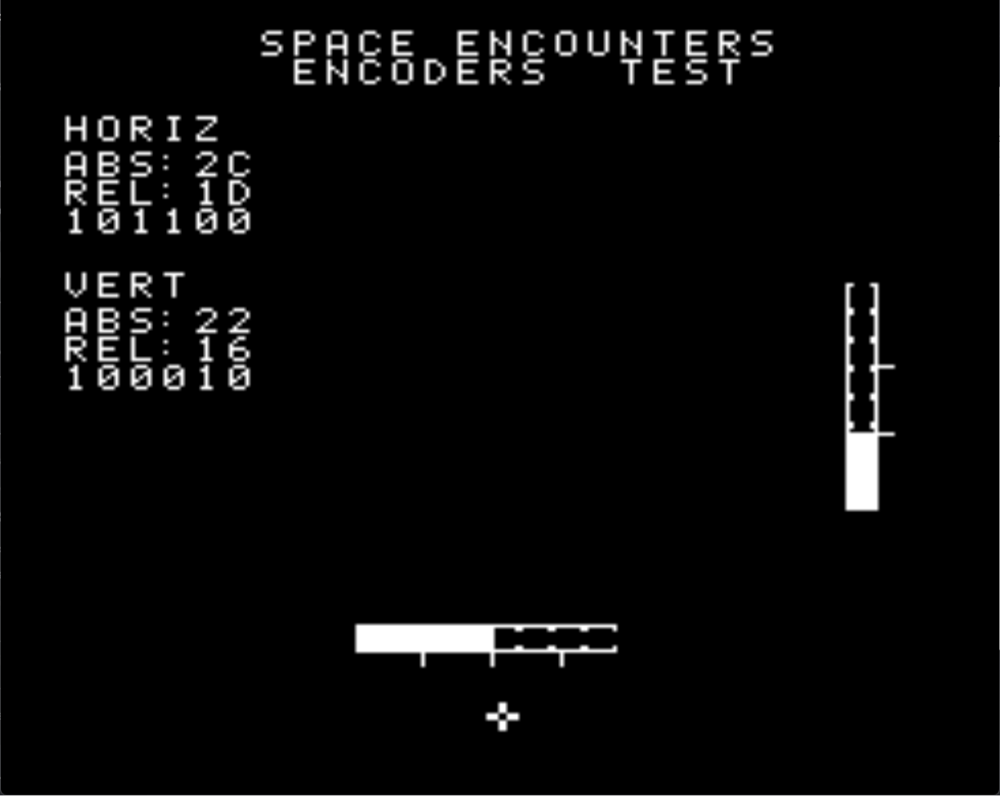

# Space Encounters Controls Test ROM Quick Start Guide
## Required Parts
- 2716 (or equivalent) 2k EPROM

## Required Tools
- EPROM Programmer (for programming test ROM)
- UV EPROM Eraser

## Burning the EPROM
This process varies from programmer to programmer suite. The overall process is as follows:
1. Plug in programmer and open software
2. Assuming connection is successful, select device type and find your 2716 EPROM keeping in mind the manufacturer of the ROM matters
    - Sometimes it is not obvious, however each manufacturer typically has a marking. You can find out who made the chip by searching online for "IC manufactuer symbols"
    - For use with a 2732 EPROM, just double up the ROM binary to create a 4k ROM file.
3. After chip is selected, verify that the ROM is blank
    - if the ROM is not blank use the UV eraser if it is a UV EPROM
4. Load the test ROM file *SEEncodersTestRom_V1_00.1H*
    - CRC32: B5A0FFF2
    - SHA-1: 6bb16d5cc97981638c4425a3e505e167a259f5d5
5. Program the device
6. Validate that the device was programmed correctly

## Using the Test ROM
We are going to be looking at the CPU board only. It is not inherently necessary to remove the board from the machine but be careful when swapping out the ROMs.
1. **Ensure the machine is powered off and no power is going to the board**
2. Carefully remove the origianl EPROM at 1H on the CPU board
    - Save this for later as when you are done you will just put the original ROM back.
3. Insert the test ROM into the now empty socket at 1H on the CPU board
    - Note the pin 1 notch, the EPROM can only operate one way
    - Inspect for any bent pins or mistakes before proceeding
4. Turn machine on and begin diagnostics

### Interpreting the Encoder Values
On the left side of the screen there are two areas in which various values are printed for both horizontal and vertical encoder values. Horizontal encoder values are for when you turn the yoke left and right. Vertical values are for when you push and pull the yoke.
MAME has provided a table of values that is representative of the encoders themselves. Because these are all six bit encoders, we can use this to not only troubleshoot the encoders, but also calibrate the machine.
Three values are printed per encoder:
- Abs: Absolute - the actual value of the encoder as interpreted by the machine
- Rel: Relative, where in the table the absolute value is
- Bin: A binary representation of the absolute value, useful for seeing if any bits are stuck.

A cursor and two bars are also given as visual means of representing the encoders. The two bars can be used for calibration purposes. The cursor is not a very good representation of how the ship in the game will be relative to the trench.

### Encoder Calibration
MAME provides bounds as a means of calibration. You can adjust the calibration by undoing the binary encoder and turning it until you are satisfied with your results. Three ticks are provided for the horizontal encoder bar: left, center, and right. When calibrating, you should have pretty close to the full range of the horizontal bar, noting the three ticks. Left should be as far as you can turn the yoke counter-clockwise. Right should be how far to the right you can turn the yoke. Center should be roughly where the yoke centers itself when you release it. Note that if your machine isn't properly lubricated or the springs are worn out, it might be tough to calibrate.

The calibration of the vertical encoder is a little bit less complicated. There are only two ticks: top and bottom. The most important position is the bottom position. If pulling the yoke back as far as it can go results in landing on that mark, you have reached calibration there.

Refer to the following tables for calibration values as defined by MAME.

#### Horizontal Encoder Calibration Values
| **Value Type** | **Left** | **Center** | **Right** |
|:--------------:|:--------:|:----------:|:---------:|
| Absolute       |    06    |     2C     |     35    |
| Relative       |    2E    |     1D     |     0C    |
| Binary (Abs)   |  000110  |   101100   |   110101  |

#### Vertical Encoder Calibration Values
| **Value Type** | **Top** | **Bottom** |
|:--------------:|:-------:|:----------:|
| Absolute       |    02   |     22     |
| Relative       |    29   |     16     |
| Binary (Abs)   |  000010 |   100010   |

## Screenshot
